# OBD Live (iOS)

**Turn your Freematics ONE+ into a live dashboard and diagnostics tool on your iPhone.**

The [Freematics ONE+](https://freematics.com/products/freematics-one-plus/) is a capable OBD-II logger, but on iPhone it has mostly been a device you configure rather than watch. Freematics' official iOS app, Freematics Controller, is built for controlling the logger. There was no iPhone app that shows what your car is doing right now, reads its fault codes and lets you dig into the raw data. OBD Live fills that gap. Plug the logger in, switch the ignition on and connect over Bluetooth. No cables, no laptop and no cloud account needed.

### Key features

- **Live dashboard.** Engine speed on a ring around the speed, an analog dial, a segmented bar, a Civic Type R style rev display or twin speed and rpm gauges, plus speed, load, throttle, coolant and intake temperatures, battery voltage, timing advance and fuel rate. Out-of-range values turn red, and readings your car doesn't report show as "—".
- **Graphs.** Tap any reading to follow it on a scrolling 18-second chart with min, average and max.
- **Fault codes.** Read stored and pending trouble codes with plain-language descriptions, see the freeze frame the car recorded when the fault was logged, check readiness monitors and clear the check-engine light (Mode 04, with a confirmation step).
- **Bus view.** Every OBD request and reply between the logger and the car, shown live.
- **Knows your car.** It reads the VIN and decodes model year, make and, for VW-group cars, the model. If the car won't give its VIN, the app tells you why.
- **Works with your car's quirks.** It asks the car which readings it supports and polls only those. It sends several readings per request where the car allows it, and falls back to one at a time when it doesn't. It reconnects by itself when the logger restarts.
- **Three looks.** *Simple*, a dark graphite design with amber accents and rounded cards, *Racing*, a carbon theme with a Type R style rev display, and *Power*, a navy theme with blue-to-red twin gauges. Switch with one tap.
- **Metric or imperial,** and a **demo mode** with simulated parked and driving data, so you can try everything without a car.

| | Simple | Racing | Power |
| --- | :---: | :---: | :---: |
| **Connect** | 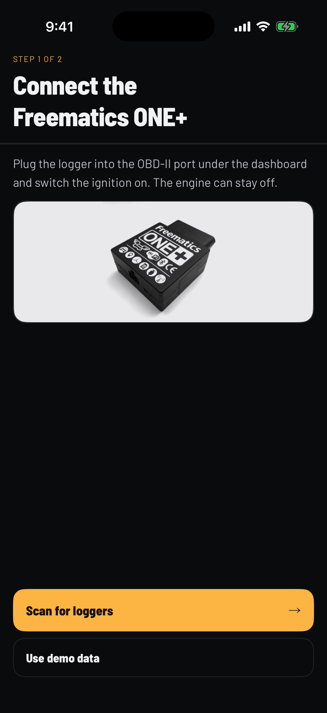 | 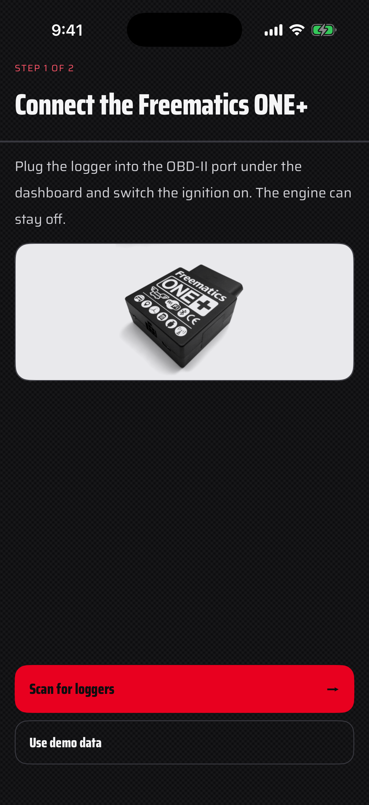 | 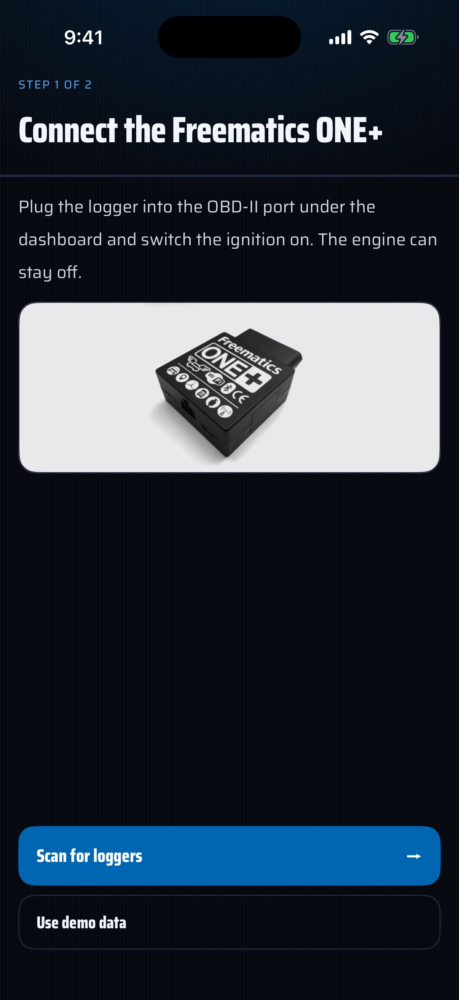 |
| **Live** | 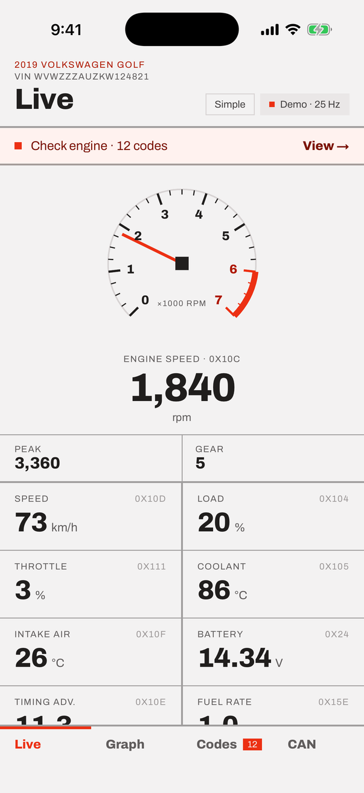 | 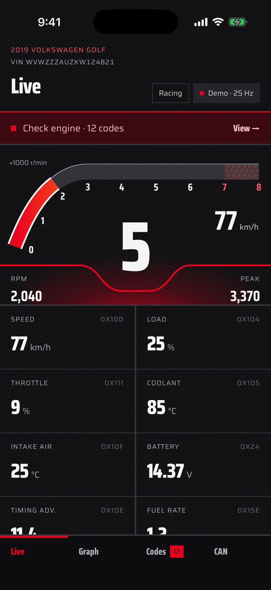 | 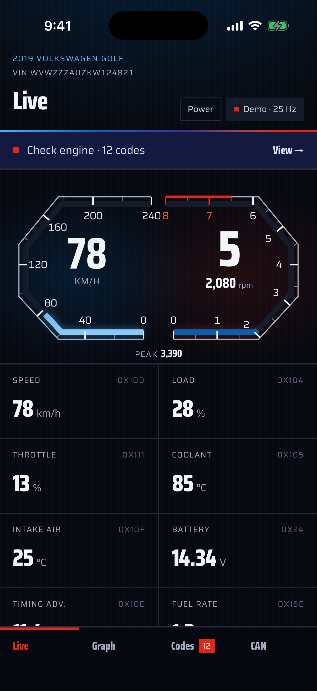 |
| **Graph** | 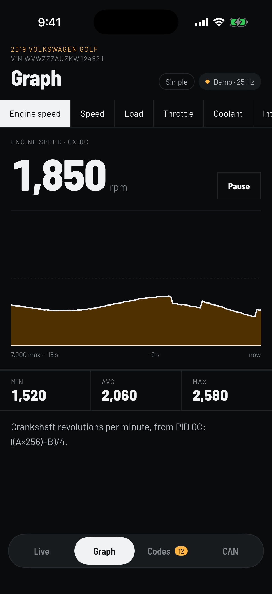 | 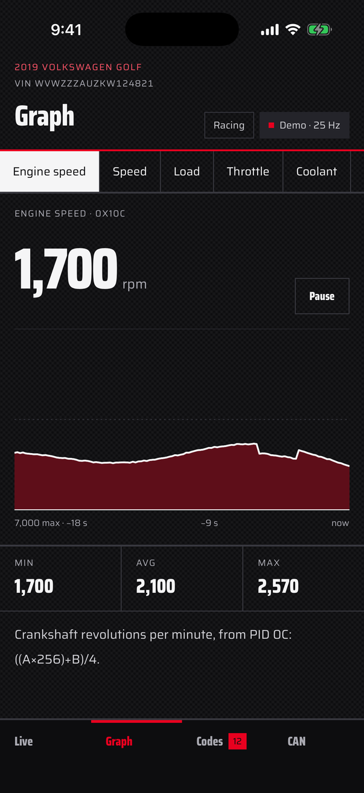 | 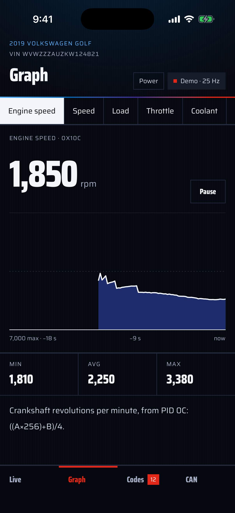 |
| **Codes** | 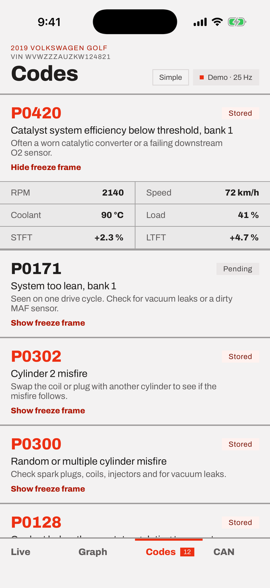 | 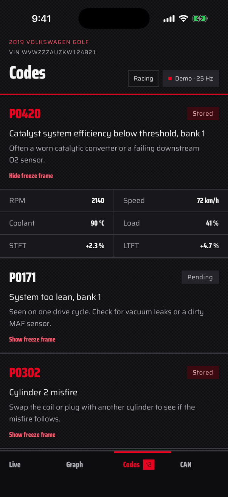 | 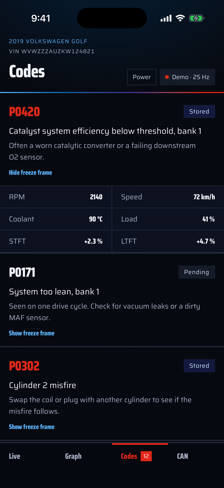 |
| **CAN bus** | 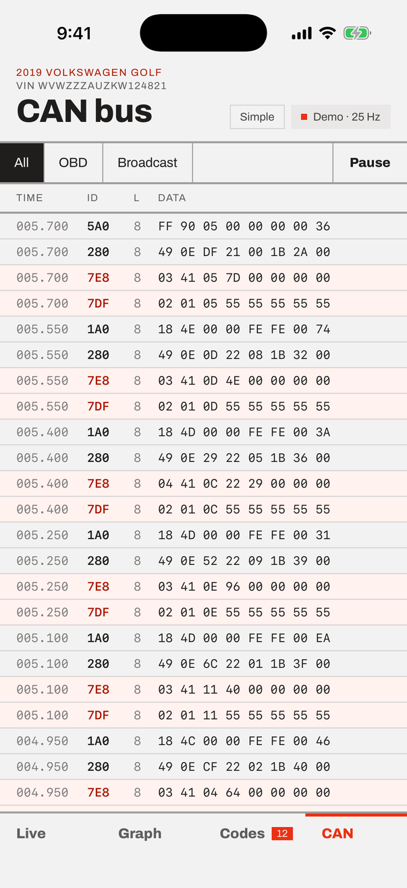 | 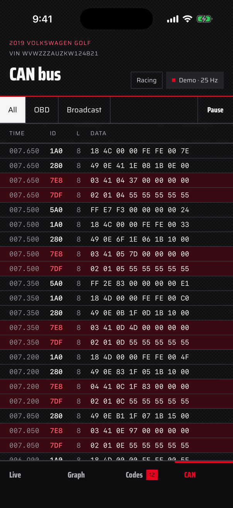 | 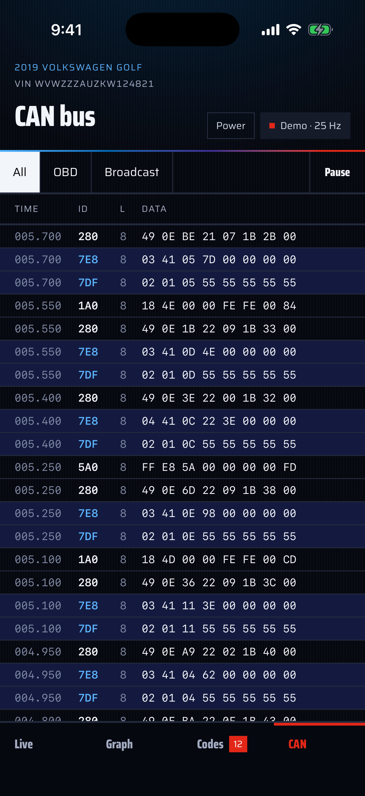 |

<sub>Demo data. Screens are captured automatically by the <code>Screenshots</code> workflow.</sub>

It works with a Freematics ONE+ running the telelogger firmware from [`karolciejka/Freematics`](https://github.com/karolciejka/Freematics/tree/obd-live-ble/firmware_v5/telelogger) (branch `obd-live-ble`; see [Logger firmware](#logger-firmware) below). The app is built in SwiftUI from the *OBD Live* prototype designed in Claude Design.

## Build

1. Open `OBDLive.xcodeproj` in Xcode 15 or later.
2. Under *Signing & Capabilities*, pick your team (the bundle id is `com.karolciejka.obdlive`; change it if needed).
3. Run on an iPhone (iOS 16+). Bluetooth doesn't work in the Simulator, but **Use demo data** does.

Core logic tests (parsing, framing, simulator) run without Xcode:

```sh
cd OBDCore && swift test
```

The design's Tweaks panel lives in the iOS Settings app under **OBD Live**: engine-speed style for the Simple skin (Ring / Dial / Bar), units (Metric / Imperial) and the simulated car (Parked / Driving) for demo mode.

## Logger firmware

The app needs the **telelogger** firmware (`firmware_v5/telelogger` in karolciejka/Freematics) with `ENABLE_BLE 1` (the default) and the `PIDS` / `RAW` BLE commands from branch `obd-live-ble`. Flash it with PlatformIO or Freematics Builder.

| | |
| --- | --- |
| Service | `0xABF0`, advertised as `FreematicsPlus` |
| Command (write) | `0xFFE1`, plain text, e.g. `PIDS0C0D0411050F0E5E` |
| Reply (notify) | `0xFFE2`, one line per command, terminated by `\r` |

What the app sends:

| When | Command | Used for |
| --- | --- | --- |
| Connect | `ATE0`, `UPTIME`, `BATT`, `VIN`, `RAW0100` | the setup log, header (model year and make from the VIN) |
| Connect | `RAW0100`, `RAW0120`, `RAW0140`, `RAW010C0D` | which PIDs the car supports; whether it answers combined requests |
| Continuously | `RAW010C0D04110F05` + `RAW010E5E` (combined), or `PIDS0C0D0411050F0E5E` | rpm, speed, load, throttle, coolant, intake air, timing, fuel rate, skipping PIDs the car doesn't answer |
| Every 2 s | `BATT` | battery voltage measured by the logger |
| Codes tab | `RAW0101`, `RAW03`, `RAW07`, `RAW020200`, `RAW02xx00` | MIL and readiness monitors, stored and pending codes, freeze frame |
| Clear codes | `RAW04` | Mode 04 clear, then the codes are read again |

## Behaviour on a real car

- **Polling rate.** The header shows the rate actually achieved (typically a few Hz over BLE), not the prototype's fixed 25 Hz. Graph history is sampled every 150 ms, so its time axis matches the design.
- **Ignition off.** The logger answers `N/A`; engine values show "—", the battery reading stays live and the header shows "No ECU".
- **Logger standby.** The telelogger powers down OBD after 3 minutes without motion; the header then shows "Standby". Firmware from `obd-live-ble` (commit `fdda8d6` or later) stays awake while the app is connected and wakes up when the app connects. If the link drops (e.g. the logger restarts when the engine starts) the app reconnects by itself, showing "Reconnecting…".
- **Gear** isn't an OBD-II PID. It's estimated from the rpm/speed ratio using typical gear ratios, and shows N when stopped or coasting.
- **Freeze frame.** OBD-II stores one freeze frame (frame 0) for the code that triggered it, so only that code shows freeze-frame values.
- **Readiness monitors** list only the monitors the ECU reports as supported, so the count may not be 9.
- **CAN tab.** The telelogger can't sniff the bus while it polls OBD, so on a real logger the tab shows the OBD requests (TX) and ECU replies (RX) relayed over BLE. Broadcast traffic only appears in demo mode.
- **Port photo.** The connect screen shows the design's striped placeholder until you add a `PortPhoto` image to `Assets.xcassets`. It's shown in grayscale.

## Layout

- `OBDCore/`: Foundation-only Swift package with the channel table, OBD-II reply parsing, BLE line framing, trouble-code descriptions and the demo simulator, plus its tests. The app target compiles these sources directly.
- `OBDLive/`: the SwiftUI app. `FreematicsLink` is the CoreBluetooth transport, `AppModel` holds the state for every screen, and there's one view file per screen.
